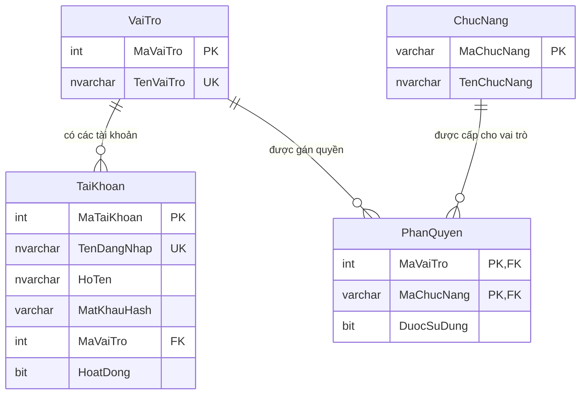

# Database đăng nhập riêng — bản xem trước

Tên database: **QLy**. [Script SQL Server](../../database/QuanLyDangNhap.sql) tạo database nếu chưa có, sau đó bổ sung 4 bảng, 4 vai trò, 6 chức năng và tài khoản mẫu. Script chưa được chạy trên SQL Server; ứng dụng hiện chưa kết nối database này.

- Một tài khoản thuộc một vai trò: Chủ cửa hàng, Thu ngân, Kho hoặc Thợ.
- `TenDangNhap` là duy nhất. `HoatDong = 0` khóa đăng nhập tài khoản.
- `MatKhauHash` chứa chuỗi băm có thông tin thuật toán, muối và tham số xác minh; không lưu mật khẩu dạng chữ thường.
- Mỗi cặp vai trò/chức năng chỉ có một dòng phân quyền. `DuocSuDung = 1` cho phép, còn `0` hoặc không có dòng quyền thì không cho phép.
- Form Quản lý tài khoản làm việc với `TaiKhoan` và danh sách `VaiTro`.
- Form Phân quyền làm việc với `VaiTro`, `ChucNang` và `PhanQuyen`.
- Sau khi ghép database, ứng dụng đọc quyền sau đăng nhập để hiển thị danh mục và kiểm tra lại quyền khi mở chức năng.

Các chức năng dự kiến: Quản lý tài khoản, Phân quyền, Tiếp nhận xe, Danh mục dịch vụ, Nhập kho phụ tùng, Báo cáo và thống kê. Đổi mật khẩu của chính mình dành cho mọi tài khoản đã đăng nhập.

Tài khoản mẫu trong script: `minh`, mật khẩu `123`, vai trò **Chủ cửa hàng**. `MatKhauHash` chứa PBKDF2-SHA256, 600000 vòng, salt và khóa dẫn xuất được mã hóa Base64. Giá trị đã được xác minh với mật khẩu mẫu trước khi đưa vào script.

Chủ cửa hàng được cấp cả 6 chức năng; Thu ngân có Tiếp nhận và Dịch vụ; Kho có Nhập kho phụ tùng; Thợ có Tiếp nhận. Ứng dụng đang áp dụng cùng bộ quyền mặc định trong bộ nhớ, chưa đọc/lưu bảng SQL. Chạy lại script không ghi đè tài khoản hoặc quyền đã có. Các lệnh `SELECT` cuối script hiển thị dữ liệu để kiểm tra.
